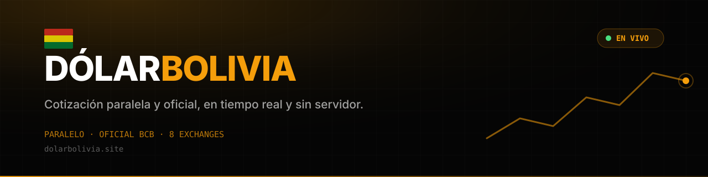
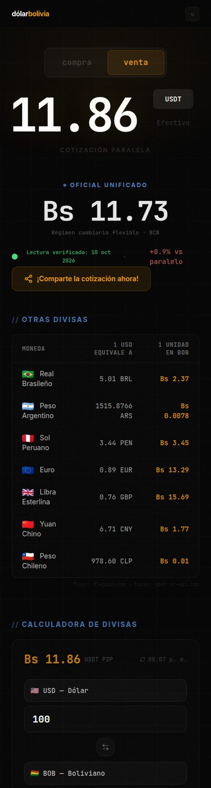
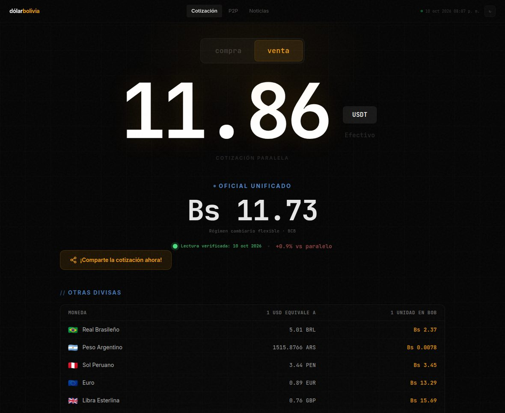

# DólarBolivia · dolarbolivia.site

**Infraestructura de cotización cambiaria para Bolivia.** Agregador multi-fuente que resuelve, en el borde y en tiempo real, el **spread compra/venta del mercado paralelo** y el **tipo de cambio oficial unificado (BCB)**, con trazabilidad de la procedencia de cada lectura. Arquitectura **serverless**: entrega estática sobre CDN y un pipeline programado que mantiene los datos frescos, con degradación controlada cuando la fuente primaria no responde.

[](https://dolarbolivia.site)
[](https://github.com/COEFR/dolarbolivia/commits/main)
[](#)
[](https://github.com/COEFR/dolarbolivia/actions/workflows/tasas.yml)

| | |
|---|---|
| **Sitio** | <https://dolarbolivia.site> |
| **API (JSON)** | <https://dolarbolivia.site/api/rates> |
| **Histórico** | <https://dolarbolivia.site/history.json> |
| **Bot de tasas** | [cada 5 min](.github/workflows/tasas.yml) (Action + disparador externo) |

---

## Capturas

| Celular | Escritorio |
|---|---|
|  |  |

---

## Qué incluye

- **Spread compra/venta del paralelo** con lectura verificada, marca temporal y ventana de validez.
- **Tipo de cambio oficial unificado** (régimen cambiario flexible, BCB) con vigencia declarada.
- **Serie temporal comprimida** (sparkline) para detección de tendencia sobre el histórico reciente.
- **Matriz multi-moneda**: 7 pares (BRL, ARS, PEN, EUR, GBP, CNY, CLP) normalizados contra USD.
- **Motor de conversión bidireccional** USD ⇄ BOB con soporte del resto de la matriz.
- **Módulo de exportación**: carta de cotización rasterizada en el cliente (html2canvas) + Web Share API de la plataforma, con fallback a portapapeles y WhatsApp.
- **Interfaz mobile-first** sobre tema oscuro (`#050505`) con acentos ámbar y tipografía monoespaciada para lectura de cifras.
- **Serverless de punta a punta**: CDN estático + pipeline programado; sin procesos residentes ni base de datos.

## Cómo funciona

```
   ┌──────────────────────────┐        ┌────────────────────────────────────────┐
   │  Navegador (celular)     │        │  GitHub Actions · tasas.yml            │
   │                          │        │  disparado cada 5 min por cron         │
   │  1. lee la referencia EN │        │  → tools/tasas.py                      │
   │     VIVO (la más al      │        │     · lee la fuente verificada         │
   │     momento)             │        │     · si no responde: Binance P2P+BCB  │
   │  2. si falla → api/rates │◄───────┤       (queda marcado como "fallback")  │
   │  3. si falla → respaldo  │        │  → escribe docs/api/rates + commit     │
   └──────────────────────────┘        └────────────────────────────────────────┘
                    ▲                                     │
                    └───────── GitHub Pages sirve ◄────────┘
```

**Cascada de resolución determinista** en tres niveles —lectura en vivo del origen verificado, snapshot precalculado por el pipeline y estimación local de respaldo— de modo que el sistema degrada con aviso explícito en lugar de publicar una cifra sin procedencia.

## API

**Contrato JSON estable**, versionado por campos y auditable: cada respuesta declara su estado de resolución, su origen y su marca temporal en UTC.

`GET https://dolarbolivia.site/api/rates`

```json
{
  "parallel": { "compra": 11.86, "venta": 11.82, "buy": 11.86, "sell": 11.82 },
  "official": { "rate": 11.73 },
  "timestamp": "2026-10-10T22:05:00+00:00",
  "status": "live",
  "fuente": "DolarBlueBolivia"
}
```

- `compra` / `venta`: el precio **alto** y el **bajo** del paralelo. La convención es la del usuario,
  la misma que publica la página de referencia: **compra** = lo que te cuesta comprar dólares (el número
  alto) y **venta** = lo que te pagan por los tuyos (el bajo). `buy` / `sell` repiten esos valores.
- `status`: `live` (lectura de la fuente verificada) · `fallback` (respaldo propio).
- `fuente`: de dónde salió el número, para poder auditarlo.
- `history.json`: histórico de lecturas en formato compacto (`[{t, b, s, o}]`).

## Desarrollo y compilación

El código de la app está en `dolarbackup/backend/src` (React + Vite + TypeScript), las configs del build en `dolarbackup/frontend-source`, y el sitio ya compilado —que es lo que se publica— en `docs/`.

```bash
cd dolarbackup/build     # carpeta de compilación
./build.sh               # sincroniza el código y compila directo a docs/
```

Para probar el generador de datos:

```bash
python3 tools/tasas.py   # escribe docs/api/rates y agrega una fila al histórico
```

## Estructura

```
docs/                     el sitio publicado (lo que sirve GitHub Pages)
  api/rates · history.json  los datos que mantiene el bot
  assets/                  sitio compilado (JS/CSS)
tools/
  tasas.py                genera las cotizaciones (fuente + respaldos)
  disparar_tasas.sh       dispara el bot (lo llama el reloj externo cada 5 min)
  publicar_pages.py       publica/activa Pages y el dominio
dolarbackup/
  backend/src             código fuente de la app (React + TS)
  frontend-source         configs del build (vite, tailwind, tsconfig)
  build                   carpeta de compilación (build.sh)
img/                      banner y capturas del README
.github/workflows/        la Action que actualiza las tasas
```

## Pendientes

- [ ] Histórico con gráfico por rango (24 h / 7 d / 30 d) desde `history.json`.
- [ ] Aviso por Telegram cuando el paralelo se mueva más de X%.
- [ ] PWA para instalarlo en el celular.

## Fuente de datos y créditos

- **Paralelo y oficial**: [DolarBlueBolivia](https://www.dolarbluebolivia.click) — su API pública es la fuente verificada y el sitio la lee **en vivo**. Respaldo propio: Binance P2P + BCB.
- **Otras divisas**: [open.er-api.com](https://open.er-api.com).
- **Diseño e implementación**: COEFR.

## Licencia

© COEFR — uso personal. Los datos pertenecen a sus fuentes; los precios son informativos y no constituyen asesoría financiera.
